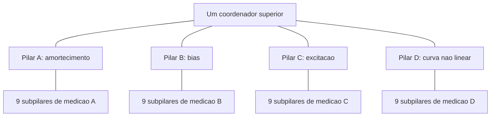
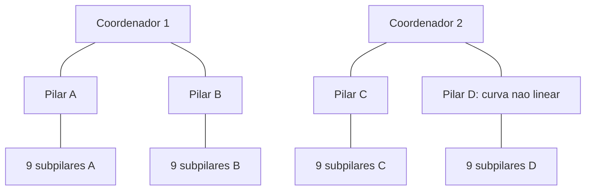

# Piramide candidata: sensores, pilares e coordenadores

## Atualização da Etapa 19: ChaosLab

O laboratório Python/NumPy com painel Streamlit está implementado. O lote de
41 ensaios concluiu 71.156 janelas, incluindo sete conjuntos pareados de
10.000 janelas (500 trajetórias × 20). A malha é fixa e não depende da interface
ou dos observadores. Nas condições saudáveis, off/cotas/concessão efetiva
produziram 7.151/10.000 acertos, estados finais e tabelas de janelas idênticos.

Sob desvio de +12 µA para Y, a concessão efetiva atingiu 7.287/10.000 contra
7.218/10.000 das cotas: 528 recuperações e 459 regressões, saldo +69. O IC95
descritivo pareado por trajetória foi +0,08 a +1,30 pontos percentuais, condicionado
às entradas e fases deste conjunto. O passo de 5 µs ainda exige confirmação.

A alternativa permanece candidata, sem aprovação final: nos cantos combinados,
alarmes indevidos caíram de 8/8 para 6/8. O refino 2,5 → 1,25 µs manteve 24/34
acertos, mas mudou 16/34 classificações. A reserva com política e filtro
compatíveis deu 25/34 contra 26/34 da proporcional imediata, com cinco
recuperações e seis regressões, para ambos os fiscais.

A referência nominal e o cancelamento ilimitado acertaram 34/34; a atuação
imediata limitada acertou 25/34. Isso evidencia perda já sem os blocos explícitos
de atraso, mas não isola o orçamento: o cancelamento ilimitado ocorre em cada
subpasso RK4, enquanto a atuação limitada é retida por passo. Da mesma forma,
L2 e comum mudam conjuntamente política, atraso e filtro nesta matriz.

Próximas prioridades: controle ilimitado também amostrado, comparação das
políticas sob atrasos iguais, refino em horizontes curtos e novos conjuntos,
e fiscal tolerante ao desalinhamento das referências. O teto de 90 µA aqui é
algébrico; a confirmação elétrica permanece no LTspice.

- [Relatório auditado da Etapa 19](etapa19/ETAPA19_RESULTADOS.txt)
- [Figura comparativa](etapa19/comparacao_etapa19.png)
- [Verificação dos 41 ensaios](etapa19/VERIFICACAO_ENTREGA.json)
- [Guia do ChaosLab](../../chaoslab/GUIA.txt)

Foram liberados 96,50 GB após retenção de fontes, métricas e extratos compactos.
O [registro de retenção](manutencao_armazenamento/NOTA_RETENCAO.txt) substitui
as afirmações históricas de preservação integral dos RAWs removidos.

## Escolha registrada na Etapa 9

Usar o seletor adaptativo como candidato quando a prioridade for preservar a protecao e reduzir a quantidade media de sensores ligados. Na etapa 9, sob quatro falhas de sensores, ele acertou 34/34 janelas com media de 3,731 ligados, como nove fixos com nove ligados continuamente. O resultado foi mantido em passo menor. O adaptativo liga os nove por periodos curtos para verificacao. Quantidade de ligados nao e consumo de energia medido; o supervisor externo tem custo ainda nao modelado.

Nove fixos continuam sendo a referencia com uma regra mais simples, sem depender da selecao dinamica. Erro comum fez todas as estrategias falharem. A escolha e para os cenarios testados, sem afirmar qual seria a melhor montagem fisica.

Para coordenacao, manter o comum como referencia: foi a melhor contagem entre as cinco regras da etapa 12 sem falha. A etapa 13 acrescentou um candidato com o mesmo topo e dois atuadores, somando A-B-C em y e mantendo D em x. Na comparacao ampliada, com precisao e sondas iguais, os quatro atuadores acertaram 252/272 janelas sem falha e os dois combinados 261/272; sob demanda alta, 49/68 e 57/68. O combinado melhorou no atraso, mas piorou na parada e inversao do topo. Ainda ha falhas e sensibilidade ao passo; nao selecionamos um vencedor universal. A corrente ficou dentro do criterio numerico em todas as 64 trajetorias novas, pela soma externa das correntes salvas.

A etapa 14 acrescentou detector por discrepancia e reserva com memoria. No perfil AB, com atuacao ideal, recuperou os quatro defeitos do comando do topo e passou em 340/340 janelas entre saudavel e falhas, nos dois passos. Com amplificadores genericos ADI, shunts e limitador nao ideal a 90 uA, a parada com heartbeat mantido passou de 31/34 sem reserva para 34/34 com reserva. A bancada do limitador chegou a 96,8 uA no candidato escolhido e 97,8 uA com tolerancias. Isso nao valida toda a piramide nem chips/PCB: a integracao nao ideal ainda precisa de refinamento e casos novos. Consulte etapa14/ETAPA14_RESULTADOS.md, inclusive a auditoria de consistencia dos medidores.

A etapa 15 ampliou a integracao nao ideal para 64 trajetorias, nos passos 1,25/0,625 us. A corrente passou em todas, com pico de 90,015769 uA pelas tensoes dos shunts. Com reserva, AB passou em 340/340 janelas; equilibrado e CD em 272/272 nas condicoes avaliadas. Alta demanda ficou em 193/272, incluindo falhas com topo saudavel (47/68), tres alarmes indevidos saudaveis e classificacoes sensiveis ao passo. Controles com atuacao ideal e mesmo RC ficaram em 50/68 a 90 uA e 56/68 a 100 uA, tambem com alarmes indevidos. Logo, ampliar capacidade ou escolher chips nao resolve por si so a validacao restante. Priorizar a consistencia do detector e a margem logica em alta demanda; manter a margem de corrente e as falhas registradas. Consulte etapa15/ETAPA15_RESULTADOS.md e etapa15/CONTROLE_CAPACIDADE.md.

A auditoria da etapa 15 localizou a causa dos alarmes indevidos: o segundo RC carregava o primeiro na referencia, enquanto os RCs do caminho de atuacao/medicao estavam isolados. O candidato atualizado, etapa15/MLC_filtros_isolados.inc, acrescenta seguidores ideais entre os RCs, sem alterar os limiares. Na regressao de 28 trajetorias, nao houve alarmes indevidos nem violacoes de corrente; pico pelos shunts 90,017140 uA. AB saudavel/silencioso passou em 136/136; alta demanda em quatro condicoes ficou em 198/272, ainda sensivel ao passo. O controle ideal corrigido ficou em 53/68. A etapa concluiu 104 trajetorias validas entre matriz, controles, auditorias e regressao; o resultado corrigido nao deve ser confundido com a matriz anterior. O problema restante e margem logica sob alta demanda, alem da realizacao fisica dos blocos. Consulte etapa15/CORRECAO_FILTROS.md.

Direcao de longo prazo informada pelo usuario: migrar o circuito validado para uma placa virtual antes de fabricar, incluindo modelos de componentes, parasitas, ruido de interconexao, alimentacao e efeitos termicos. O roteiro esta em etapa14/PLANO_ETAPA14.md. As escolhas seguintes devem preservar interfaces de comando e medicao e substituir gradualmente os blocos ideais por realizacoes especificas.

## Quantidades e estado dos testes

- Dois pilares de correcao formaram a base do ensaio de selecao: A (amortecimento) e B (bias).
- Um terceiro, C (amplitude da excitacao), foi modelado e comparado na etapa 10, com melhora relativa e sensibilidade numerica no cenario forte.
- Os nove subpilares de medicao e o seletor adaptativo foram testados apenas no pilar B. A e C ainda usam replicas unicas nos seus ensaios.
- D foi definido na etapa 11: compensa uma deriva multiplicativa da curva nao linear g(x), atuando no estado x. Com desvio isolado de +/-1%, manteve 34/34 janelas em tres passos; sem D houve falhas. O sensor ainda e uma replica comportamental favoravel.
- Quatro pilares com nove subpilares cada significam 36 unidades de medicao candidatas. A/B/C corrigem o mesmo estado y e podem solicitar uma corrente combinada; D atua em x. Portanto quatro funcoes de estimacao nao exigem quatro atuadores. Dois e quatro atuadores foram comparados na etapa 13; os blocos nao correspondem a uma contagem de componentes fisicos.

## Interpretacao da piramide

A base mede. O meio estima e pede a correcao especifica. O topo coordena os recursos e a ativacao. Interpretamos os blocos de cima como coordenadores dos pilares, em vez de repetir automaticamente a mesma atuacao da camada de baixo. A porta logica e o sistema controlado; ela nao e o coordenador.

Diagrama de proposta, ainda nao simulado como conjunto. Leituras, prontidao e pedidos de corrente sobem; selecao, limites e comandos de ativacao descem. Cada grupo de nove mede a mesma grandeza do seu pilar e pode trabalhar normalmente com tres validos, usando os demais em verificacoes. A transferencia do seletor de B para A/C/D exige novos testes; erros e velocidades de variacao podem ser diferentes.

## Um ou dois no topo

**Um coordenador comum:** recebe as demandas de todos os pilares e reparte uma capacidade total entre eles. Um canal pode usar capacidade ociosa de outro. A etapa 12 comparou cinco regras com A/B/C/D e sensores continuos: o comum acertou 259/272 janelas sem falha do topo, dois grupos fixos 238/272, emprestimo 251/272 e prioridade 252/272. A reserva local igualou o comum sem falha. A piramide com quatro grupos adaptativos ainda nao foi testada.

**Dois coordenadores por grupos:** cada um atende dois pilares. Uma primeira comparacao pode reservar metade da mesma capacidade total para cada grupo. Essa separacao limita conflitos entre comandos, mas pode deixar recurso ocioso num grupo enquanto falta no outro. Permitir transferencia entre coordenadores exige uma regra comum adicional e respectivo atraso, nao capacidade extra gratuita.

Dois coordenadores duplicados para os mesmos canais seriam outro teste: precisariam de arbitragem quando discordassem. Duplicar nao mostra sozinho qual deles esta correto. O desenho acima usa grupos distintos, nao dois controladores concorrendo por cada atuador.

## O que a hierarquia deve acrescentar

Cada camada precisa ter uma funcao propria mensuravel: selecionar medicoes, estimar um desvio, distribuir corrente ou diagnosticar falhas. Uma nova camada que somente encaminha o mesmo sinal precisa ser avaliada pelo atraso e pelo custo que adiciona. A piramide nao elimina erro compartilhado pelos sensores ou falha do topo.

## Comparacao que decidiria entre os desenhos

1. Integrar primeiro o seletor adaptativo aos canais ja definidos, A e B, e depois C/D, mantendo a porta, a sequencia e a capacidade total. Aplicar erros e despertar a cada grupo; nao supor que a mediana de B automaticamente valida os demais.
2. Comparar o mesmo conjunto de canais com um coordenador e com dois por grupos, incluindo seus atrasos e a mesma capacidade total. Contar custo e trocas de supervisao.
3. D ja foi acrescentado para deriva multiplicativa da curva nao linear. Investigar agora erros independentes nas inclinacoes, deslocamento das quebras e medicao real do parametro. A necessidade demonstrada no desvio isolado nao garante melhora em toda combinacao de perturbacoes.
4. Medir janelas e trajetorias corretas, margem, latencia, quantidade de sensores ligados, trocas e saturacao. Incluir ruido, falhas isoladas, falha comum, falha do topo e casos novos em relacao aos usados para desenhar o seletor.
5. Retirar cada camada para verificar sua contribuicao. Escolher a menor arquitetura que satisfaça os requisitos dentro do modelo e registrar as falhas, antes de traduzir para componentes reais.

Esta proposta responde a organizacao da ideia. Ainda nao e resultado de uma simulacao da piramide completa nem recomendacao de hardware. Evidencias: etapa9/ETAPA9_RESULTADOS.md, etapa10/ETAPA10_RESULTADOS.md, etapa11/ETAPA11_RESULTADOS.md, etapa12/ETAPA12_RESULTADOS.md, etapa12/MEDICAO_CORRENTE.md e etapa13/ETAPA13_RESULTADOS.md. O pequeno excesso indicado pelo monitor de corrente da etapa 12 nao foi confirmado pela soma independente das correntes nos oito casos repetidos; os demais casos antigos continuam sem essa conferencia.

## Etapa 16 — reserva local E dedicada a D

Foram concluidas 82 trajetorias novas no LTspice, alem da reanalise de 16 referencias corrigidas da etapa 15. Com o mesmo orcamento operacional de 90 uA, E revisado acertou 184/272 janelas de alta demanda, a referencia 198/272 e a prioridade em D com dois atuadores 189/272. E reduziu o residuo RMS da compensacao de D de 21.188 para 13.366 uA, mas o residuo do canal A-B-C passou de 40.717 para 49.579 uA. A variacao de g(x) ficou em 1001.34/1003.10 V/s do modelo (referencia/E); isso nao equivale a estresse termico.

As divergencias entre 1,25 e 0,625 us foram 42/136 na referencia e 40/136 em E. O terceiro passo de 0,3125 us ainda apresentou falhas. A reserva fixa de 20 uA ficou em 42/68 sem falha do topo. Uma cota exploratoria de E de 5 uA ficou em 49/68, contra 51/68 da referencia saudavel; esse ajuste nao foi expandido a todas as falhas ou ao terceiro passo.

A corrente passou nas 82 trajetorias novas pelas tres leituras, com pico pelos shunts de 90.025842 uA. A checagem previa encontrou uma inconsistência de cota na primeira reserva livre; a versao v2 a corrigiu, preservando os pilotos. Com perturbacoes em 75% e 50% da intensidade original, a referencia passou em 66/68 e 68/68. Isso delimita uma faixa mais favoravel, mas nao resolve o requisito de alta demanda original.

E tem nove leituras comportamentais e mediana explicita, ligadas apenas a sua funcao local de apoio a D. O comando E nao passa pelo topo; alimentacao e limitador continuam compartilhados. A saturacao utilizada e a falta de cota para atender D, nao uma falha fisica identificada no amplificador. A proposta completa tem 45 subpilares (5 x 9); A/B/C/D ainda usam replicas unicas neste lote. O conjunto de 45, o seletor adaptativo e chips/PCB permanecem por validar.

Manter E como candidato de reserva especializada, sem incorpora-lo como solucao aprovada para a alta demanda. O proximo foco e estudar a reparticao entre os estados x/y e a capacidade necessaria para preservar margem logica, com validacao em passos menores e condicoes novas. A referencia com dois atuadores continua disponivel. Relatorio: etapa16/ETAPA16_RESULTADOS.txt; grafico: etapa16/comparacao_pilar_E.svg; resultados completos e verificacao: etapa16/trajetorias.json, etapa16/janelas.csv e etapa16/verificacao_entrega.json.

## Etapa 17 — coordenador associado a E

Concluídas 64 trajetórias novas no LTspice, com orçamento operacional de 90 µA incluindo E (até 5 µA). Comparação funcional de coordenador comum e grupos ABC / D+E; cotas com transporte de 20 µs e filtro de 50 µs. Cotas complementares e arbitragem única impedem concessões duplicadas.

| Arquitetura | Janelas corretas | Corretas nos dois passos |
|---|---:|---:|
| Referência anterior | 198/272 | 78/136 |
| Comum com supervisor E | 199/272 | 80/136 |
| Grupos com empréstimo e supervisor E | 174/272 | 70/136 |

O saldo de uma janela no novo comum não demonstra ganho robusto; a sensibilidade ao terceiro passo permanece. A coordenação comum segue como base de pesquisa, com verificação da idade e da coerência das cotas ainda pendente.

Controle saudável 45/45: 38/68. Ajuste exploratório L2: 49/68 com filtro e 53/68 com cotas ideais instantâneas. O ajuste foi motivado pelo déficit em Y, sem acesso à resposta AND; não recebeu a matriz completa de falhas nem terceiro passo.

Corrente: pico físico 90.021849 µA; critério herdado <=100,005 µA. Falhas de heartbeat e soma de cotas têm fallback 45/45. Uma cota válida, mas enviesada, exige verificação distinta da discrepância entre comando e atuação. O supervisor continua sendo uma dependência compartilhada dos grupos.

Os resultados não validam chips/coordenadores fisicamente independentes, a pirâmide completa de 45 sensores ou PCB. Modelos antigos e ondas de referência foram preservados. Relatório e evidências: [Etapa 17](etapa17/ETAPA17_RESULTADOS.txt), [comparação](etapa17/comparacao_coordenadores.svg), [verificação](etapa17/verificacao_entrega.json).

## Etapa 18 — Fiscalizacao das cotas e recuperacao local

CONCLUSAO REVISADA

Manter um coordenador comum como referencia de arquitetura, com E como
reserva local e fiscal dentro do mesmo orcamento. O lote nao justifica
substitui-lo por dois coordenadores de grupos, nem declara o circuito
pronto. L2 com confirmacao V2 continua candidato de pesquisa.

O fiscal detectou 24/24 trajetorias com falha de cotas e comutacao
habilitada, sem contar memorias armadas antes da injecao. Isso inclui
heartbeat perdido, concessao dupla, cota extrema 0/90, desvio de ate
12 uA, atraso com carimbo antigo e cota antiga com carimbo recente.
Nas duas falhas simultaneas, os detectores de comando e de cota
atuaram; o detector de comando nao teve alarme indevido neste lote.
Esses resultados sao deteccao no modelo, nao tolerancia fisica de chips.

O limite mais importante encontrado foi a tolerancia do fiscal V1.
No comum nominal houve 0/4 alarmes indevidos; nos dois cantos combinando
RC, atraso, ruido e relogio houve 4/4 trajetorias saudaveis com alarme.
As idades permaneceram validas: a discrepancia de valores provocou a
comutacao, entre 2.238 e 2.332 ms. Nao e uma configuracao qualificada
para hardware. Nos quatro instantes de primeiro disparo, as cotas ainda
cobriam ambos os pedidos. Isso reforca a hipotese de fiscalizar a
concessao efetiva, sem provar que essa alternativa eliminaria o problema.
Os cantos nao sao uma distribuicao estatistica.

No L2 5/10 us, a V1 disparou em 4/4 trajetorias saudaveis. A revisao
V2, que altera somente a carga/descarga da confirmacao de 20/40 para
50/20 us, teve 0/4 alarmes saudaveis. Detectou tambem 2/2 casos de
cota antiga com carimbo recente e 2/2 de cota extrema. O viés extremo
foi detectado em 60.38 us; o replay em 2.0602 ms desde a partida,
incluindo a inibicao de 2 ms. A V2 ainda precisa dos cantos de
tolerancia, terceiro passo e demais falhas antes de ser escolhida.

Detectar e recuperar a logica sao problemas diferentes. Com cota
extrema no comum, habilitar a reserva mudou 47/68 para 43/68 acertos:
oito janelas recuperadas e doze novas falhas. No L2 5/10 saudavel,
comutacao desabilitada deu 55/68, V1 deu 43/68 e V2 deu 56/68.
Entre o controle desabilitado e V2 ocorreram onze recuperacoes e dez
regressoes. Sem disparo, ambos usam a mesma politica efetiva; alterar
o observador pode mudar os passos adaptativos. A diferenca de uma
janela nao prova melhora fisica causada pela V2.

Reduzir atraso/filtro de L2 de 20/50 para 5/10 us, com comutacao
desabilitada, mudou 51/68 para 55/68: dez recuperacoes e seis regressoes.
O residual RMS de Y caiu de 39.824 para 37.646 uA; D ficou em
23.806/23.748 uA. Frente ao comum nominal, L2 V2 reduziu o residual
de Y (44.544 -> 37.914 uA), mas aumentou o de D+E (19.061 ->
23.832 uA). A variacao total de g(x) permaneceu proxima: 1000.49/s
no comum e 1001.42/s em L2 V2. Nao ha reducao uniforme demonstrada
do esforco dinamico; essas medidas nao equivalem a estresse termico.

A convergencia numerica permanece aberta. O comum acertou 25, 23 e
28 de 34 janelas com passos 1.25, 0.625 e 0.3125 us; as duas
comparacoes sucessivas tiveram oito e onze discordancias. O L2 V1
com reserva deu 23, 20 e 25, com cinco e treze discordancias. Os
alarmes indevidos de L2 V1 persistiram no terceiro passo. L2 V2
acertou 30/34 e 26/34 nos dois passos, com oito discordancias.

As 64 trajetorias passaram no teto legado de 100.005 uA pelas tres
leituras. Os picos foram 90.022504 uA por tensao/shunt, 90.022613 uA
pelas correntes dos resistores e 90.804677 uA pelas sondas 0 V.
O maior pico da sonda coincide com um passo de 6.38e-16 s e shunts
quase constantes, sugerindo dificuldade numerica ainda nao isolada.
Nenhuma amostra foi removida. Nao foi demonstrado teto fisico estrito
de 90 uA. O comando de E respeitou 5 uA, mas seu pico fisico chegou
a 5.353212 uA. Esses limites sao de atuacao, nao consumo total da placa.

Prioridade do proximo lote: comparar concessao efetiva min(|pedido|,
cota), para nao reagir apenas a capacidade ociosa; confrontar essa
revisao e a V2 nos cantos de tolerancia e sob falhas; testar uma
reserva local com politica/filtro proximos aos nominais. Manter idade,
heartbeat e guarda global em paralelo. Isolar tambem a divergencia
das sondas e repetir o refinamento antes de prometer limites fisicos.
Sincronismo por mais de 0.85 s e retorno seguro apos reparo seguem
pendentes. Nenhum desses ensaios futuros foi contabilizado aqui.

Executadas 64 trajetorias completas novas (1088 janelas), com 56 da
matriz V1/controles/refinamento e oito da confirmacao V2. Comparacao
logica conferida tambem diretamente nos RAWs; plano e adendos preservados.

- [Relatorio completo](etapa18/ETAPA18_RESULTADOS.txt)
- [Comparacao visual](etapa18/comparacao_etapa18.svg)
- [Diagnostico da confirmacao](etapa18/diagnostico_confirmacao.svg)
- [Contrato para proximos modelos](etapa18/INTERFACE_PARA_PROXIMOS_MODELOS.txt)
- [Verificacao da entrega](etapa18/verificacao_entrega.json)
- [Errata da integracao de indicadores](etapa18/ERRATA_INTEGRACAO_INDICADORES.txt)
- [Correcao dos dados anteriores](etapa18/correcao_fracoes_anteriores.json)

Corrigido o helper compartilhado: integrar indicadores booleanos exige
conversao a float. Recalculadas 162 trajetorias unicas, corrigindo 184
registros das Etapas16/17 e a tabela impressa da Etapa16, com backups.
A referencia saudavel superava 91 uA em 62.15% do tempo (antes 31.12%).
Contagens de janelas, picos, alarmes, RMS e variacao total de g(x)
foram preservados.

Mantida a ressalva: 90 uA e cota de atuacao; controle/metadados ainda
comportamentais, 45 subpilares conceituais, nenhuma PCB ou chip especifico
validado. Os resultados desta matriz nao substituem a matriz 198/272 anterior.
