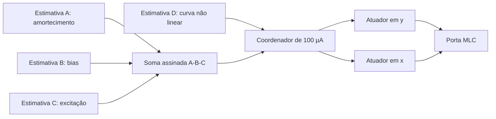

# Etapa 13: combinar correções antes de repartir a capacidade

A/B/C estimam desvios distintos, mas os três corrigem a equação do mesmo estado y. Podemos somar seus pedidos com os sinais corretos antes da limitação e usar um atuador bidirecional em y. D continua com atuação em x. Esta comparação preserva as quatro funções de estimação e muda a arquitetura de atuação: quatro fontes independentes versus duas fontes com pedidos combinados.

Na referência, o ganho h é calculado a partir de |d_A|+|d_B|+|d_C|+|d_D|; as correntes resultantes são I_y=h*(d_A-d_B-d_C) e I_x=h*d_D. Na alternativa, primeiro calculamos d_y=d_A-d_B-d_C; o ganho passa a considerar |d_y|+|d_D| para aplicar dois comandos sob 100 µA. Correntes em x e y continuam contadas em módulo separadamente. Não usamos a resposta AND esperada para controlar os atuadores.

Por exemplo, pedidos de A=+40 µA, B=+35 µA e C=0 resultam em +5 µA em y, pois B tem sentido oposto a A na equação. Quatro atuadores gastariam 75 µA de capacidade de atuação nesse par antes de somar seus efeitos; um atuador combinado pede 5 µA. Isso é uma diferença de capacidade de corrente no modelo, não uma medida de energia poupada.

## Comparação ampliada

64 trajetórias, 1088 janelas: 32 trajetórias sem falha e 32 com falha. As arquiteturas usam os mesmos quatro perfis da etapa 12, x inicial=-0,37/+0,37, y=-0,2, passos máximos 2,5 e 1,25 µs, reltol=1e-6, vntol=1e-11 e abstol=1e-12. Cada perfil por arquitetura tem quatro trajetórias e 68 janelas; o requisito de passar nos dois passos tem 34 janelas pareadas. Não se somam quatro perfis de uma arquitetura com resultados de outra precisão.

Mesmos erros, latência de 50 µs e filtro de 100 µs dos sensores anteriores. São réplicas contínuas; os quatro grupos de nove sensores adaptativos ainda não foram integrados. Todos mantêm a proteção que rejeita comando de sinal oposto ao pedido atual e limita a soma restante. Com atuador combinado, a verificação de sinal usa o pedido líquido em y; na referência, usa cada pedido individual.

Cada atuador contém uma sonda ideal de 0 V em série. Além do monitor interno, somamos as correntes salvas dessas sondas fora do LTspice, no mesmo instante. A capacidade nominal é 100 µA; o critério de verificação numérica é 100,005 µA. Os logs devem ter as 17 janelas completas e cada RAW chegar a 0,85 s.

| Perfil | Quatro atuadores | Dois combinados | Quatro: passam nos dois passos | Dois: passam nos dois passos |
|---|---|---|---|---|
| Equilibrado | 68/68 | 68/68 | 34/34 | 34/34 |
| AB exige mais | 68/68 | 68/68 | 34/34 | 34/34 |
| CD exige mais | 67/68 | 68/68 | 33/34 | 34/34 |
| Todos exigem | 49/68 | 57/68 | 17/34 | 23/34 |

| Arquitetura | Acertos sem falha | Trajetórias completas sem falha | Pico das correntes salvas (µA) | Casos fora do critério |
|---|---|---|---|---|
| separados | 252/272 | 11/16 | 100.000005659 | 0/32 |
| combinados | 261/272 | 12/16 | 100.000004750 | 0/32 |

## Sensibilidade ao passo

| Perfil | Arquitetura | Passo 2,5 µs | Passo 1,25 µs | Classificações alteradas |
|---|---|---|---|---|
| Equilibrado | separados | 34/34 | 34/34 | 0 |
| Equilibrado | combinados | 34/34 | 34/34 | 0 |
| AB exige mais | separados | 34/34 | 34/34 | 0 |
| AB exige mais | combinados | 34/34 | 34/34 | 0 |
| CD exige mais | separados | 33/34 | 34/34 | 1 |
| CD exige mais | combinados | 34/34 | 34/34 | 0 |
| Todos exigem | separados | 24/34 | 25/34 | 15 |
| Todos exigem | combinados | 30/34 | 27/34 | 11 |

Estas são contagens determinísticas dos ensaios. Alterações de classificação mostram sensibilidade numérica. Nem a soma dos dois passos nem passar em ambos prova convergência contínua, confiabilidade física ou probabilidade de sucesso. Os casos foram herdados de ensaios já conhecidos; este é um estudo de arquitetura e não um conjunto independente de seleção.

## Falhas do topo

As falhas 1, 3 e 4 duram de 343,35 a 403,35 ms; a falha 2 introduz atraso permanente de 500 µs nos comandos. Todas afetam o topo inteiro e seus atuadores em ambas as arquiteturas. Assim, a extensão compara o mesmo domínio de falha, diferentemente das falhas locais de grupo da etapa 12. O combinado não tem reserva local e não diagnostica o heartbeat; nas falhas 1 e 4, seu comando de atuação é zero nos dois casos.

| Falha do topo, perfil AB | Quatro atuadores | Dois combinados | Quatro: passam nos dois passos | Dois: passam nos dois passos |
|---|---|---|---|---|
| Sem falha | 68/68 | 68/68 | 34/34 | 34/34 |
| Parou e perdeu heartbeat | 64/68 | 61/68 | 32/34 | 30/34 |
| Atraso permanente de 500 µs | 52/68 | 55/68 | 23/34 | 24/34 |
| Sinal invertido | 64/68 | 62/68 | 32/34 | 31/34 |
| Parou com heartbeat mantido | 65/68 | 61/68 | 32/34 | 30/34 |

## Primeiro ensaio preservado

Antes da queda de conexão, já havia 24 trajetórias e 408 janelas completas em COMB_comum, COMB_combinado e COMB_falhas. A comparação sem falha cobria dois perfis e a falha do combinado cobria o perfil AB em passo 2,5 µs. Os resultados, modelos, logs, RAW e manifestos antigos foram preservados em resultados.csv e resumo.json; a extensão usa arquivos separados.

| Primeiro ensaio, sem sondas de corrente | Comum | Combinado |
|---|---|---|
| Equilibrado | 68/68 | 68/68 |
| Todos exigem | 46/68 | 57/68 |

O primeiro ensaio acusou dois picos do monitor do comum acima de 100,005 µA. Esses arquivos não salvavam separadamente as correntes dos atuadores, portanto não sustentam uma verificação independente da corrente aplicada. A conferência da etapa 12 demonstrou uma discrepância entre monitor e correntes em oito casos repetidos; ela não corrige automaticamente todos os outros logs históricos. A extensão acima utiliza sondas e soma externa.

## Interpretação e próximos critérios

Nos ensaios sem falha, quatro atuadores acertaram 252/272 janelas e dois combinados 261/272. No perfil de maior demanda, foram 49/68 e 57/68, respectivamente. Sob atraso do topo, foram 52/68 e 55/68; sob parada com perda de heartbeat, 64/68 e 61/68. A soma melhora algumas condições e piora outras. Não há vantagem uniforme de tolerância a falhas.

A combinação elimina a disputa de capacidade entre pedidos opostos no mesmo estado. Não elimina erro compartilhado de sensores, saturação quando o pedido líquido excede o limite, falha do coordenador nem os atrasos dos comandos. Um atuador compartilhado também concentra a falha de atuação de A/B/C: não testamos perda, travamento, alimentação ou limitação individual desse atuador. Não estimamos custo, consumo ou área de componentes reais, nem reestimamos Lyapunov em todos estes casos.

O comum foi a melhor referência entre as cinco regras da etapa 12 sem falha. A soma é uma alternativa de atuação a comparar com essa referência; nenhuma contagem com falhas autoriza chamar a arquitetura de plenamente confiável. O passo seguinte da pesquisa deve usar casos novos, um limitador físico e detecção por discrepância entre pedido e atuação, antes de integrar os quatro grupos adaptativos.

## Reprodução e arquivos

Primeiro ensaio: preparar_combinacao.py e lotes.json. Extensão: preparar_conferencia_ampliada.py e lotes_ampliados.json; executar.ps1 -Manifest lotes_ampliados.json, dividindo o lote com Slot=0/1 e Slots=2 se desejado. analisar_conferencia_ampliada.py valida os logs e RAW; gerar_relatorio.py produz este documento. resultados_ampliados.csv tem todas as janelas, trajetorias_ampliadas.json registra correntes e pedidos, e resumo_ampliado.json guarda as contagens pareadas. A conferência independente anterior está em ../etapa12/MEDICAO_CORRENTE.md.
