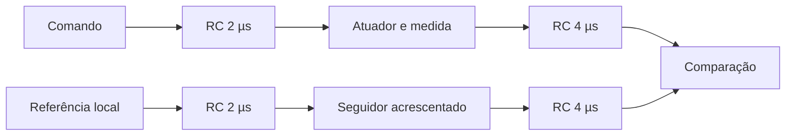

# Correção da carga entre filtros da referência

A referência tinha um RC de 2 µs conectado diretamente a outro de 4 µs. O segundo carregava o primeiro. Na atuação, o RC de 2 µs terminava em uma entrada comportamental de alta impedância; a medição, por sua vez, excitava o RC de 4 µs por uma fonte de tensão. Assim, os dois caminhos não tinham a mesma resposta, mesmo com um atuador ideal.

Para resistores de 1 kΩ e capacitores de 2/4 nF, a transferência dos RCs de referência antes da correção era H(s)=1/(1+10e-6 s+8e-12 s²). Dois RCs isolados dão H(s)=1/(1+6e-6 s+8e-12 s²). A diferença resulta das ligações, sem depender do modelo do amplificador. A constante do primeiro RC isolado era 2 µs, mas ele não estava isolado no circuito anterior.

A correção acrescenta um seguidor ideal entre os RCs da referência nos canais y e D. Não muda os limiares (3 µA+10%), o tempo de confirmação, o ruído, a reserva, o alvo de 90 µA nem o limite aceito. Para uma realização física, o seguidor precisará ser implementado e caracterizado com seus erros e largura de banda.

## Regressão da correção

24 trajetórias com atuação não ideal: AB saudável/silencioso e alta demanda saudável/silencioso/atrasado/invertido; quatro com atuação ideal de 90 µA em alta demanda saudável. Todas nos dois passos e dois estados iniciais. Esta regressão não repete todas as condições da matriz original.

| Arquivo | Acertos antes | Acertos depois | Alarmes indevidos antes → depois | Corretas depois nos dois passos | Diferenças entre passos depois |
|---|---:|---:|---:|---:|---:|
| BUF_p1_f0 | 68/68 | 68/68 | 0 → 0 | 34/34 | 0 |
| BUF_p1_f4 | 68/68 | 68/68 | 0 → 0 | 34/34 | 0 |
| BUF_p3_f0 | 47/68 | 51/68 | 3 → 0 | 20/34 | 11 |
| BUF_p3_f4 | 50/68 | 49/68 | 0 → 0 | 20/34 | 9 |
| BUF_p3_f2 | 44/68 | 49/68 | 0 → 0 | 19/34 | 11 |
| BUF_p3_f3 | 52/68 | 49/68 | 0 → 0 | 19/34 | 11 |
| BUF_ideal90 | 50/68 | 53/68 | 2 → 0 | 21/34 | 11 |

Pico pelas tensões dos shunts nesta regressão: 90.017140 µA. Trajetórias acima do teto: 0/28. Alarmes indevidos: 0/28 (casos sem falha e períodos anteriores às falhas temporárias; o atraso permanente não tem um período saudável inicial).

A avaliação dos alarmes indevidos é separada da avaliação lógica. Corrigir o diagnóstico não implica eliminar as falhas lógicas em alta demanda nem validar sensores, realimentação e PCB completos. Os resultados antes da correção permanecem preservados.

Evidências: filtros_trajetorias.json, filtros_janelas.csv e filtros_resumo.json; modelos MLC_filtros_isolados.inc e MLC_ideal_filtros_isolados.inc; decks BUF_*.cir e respectivos logs/RAW. preparar_correcao_filtros.py gera apenas a alteração de isolamento; analisar_correcao.py compara com os resultados anteriores.
